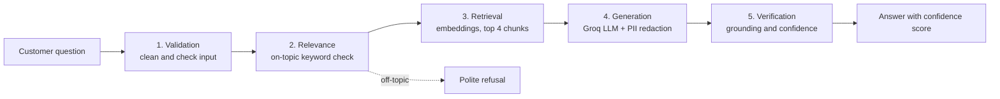
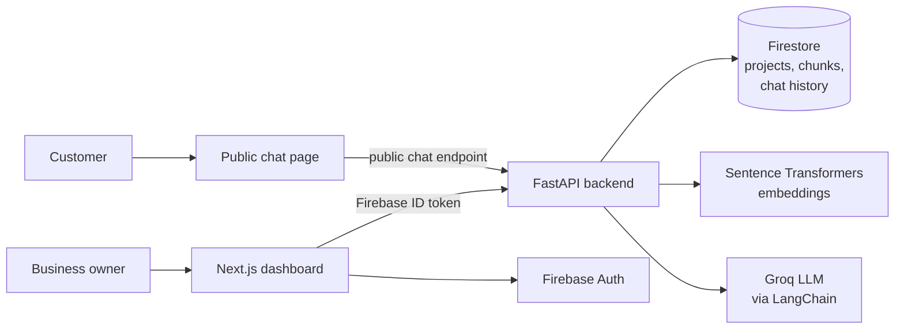

# Smart Receptionist

> A multi-tenant RAG chatbot platform. Businesses upload their PDFs, and each gets a shareable AI receptionist that answers customer questions only from those documents, with guardrails that redact personal details and check every answer is grounded.

       

<!-- Demo: add a GIF of uploading a PDF and asking the chatbot a question, e.g. docs/demo.gif -->

## Why it matters

Small businesses answer the same questions every day about opening hours, pricing and policies. A generic chatbot can make things up. Smart Receptionist only answers from the business's own documents, refuses off-topic questions, and scores how well each answer is supported, so owners can trust what it tells their customers.

## Features

- **Upload and go:** upload PDFs to a project, and they're split into overlapping chunks and embedded in the background
- **Shareable chatbot:** each project gets its own public chat link to put on a website
- **Five-layer answer pipeline** (below) with input validation, relevance filtering, retrieval, generation and verification
- **Privacy guardrail:** emails and phone numbers are redacted from answers
- **Grounding check:** every answer gets a confidence score based on how much of it is supported by the retrieved documents
- **Analytics dashboard:** total messages, average confidence and the share of grounded answers per project
- **Multi-tenant and secure:** Firebase Authentication for owners, per-project data in Firestore, Firestore security rules and bearer-token auth on owner endpoints, while the customer chat stays public

## How an answer is produced



| Layer | What it does |
|---|---|
| 1. Validation | Normalises the text and rejects empty or oversized input |
| 2. Relevance | A cheap keyword check that turns away off-topic questions before any model is called |
| 3. Retrieval | Embeds the question with `all-MiniLM-L6-v2` and returns the 4 most similar chunks above a similarity threshold |
| 4. Generation | Builds a prompt from the retrieved context, calls a Groq-hosted model through LangChain, and redacts emails and phone numbers |
| 5. Verification | Measures how much of the answer is supported by the retrieved chunks and how well it matches the question, then assigns a confidence score |

## Architecture



## Tech stack

| Area | Technologies |
|---|---|
| Backend | Python, FastAPI, Pydantic |
| AI and retrieval | LangChain, Groq, Sentence Transformers (`all-MiniLM-L6-v2`), PyPDF2 |
| Data and auth | Firebase Authentication, Cloud Firestore, Firestore security rules |
| Frontend | Next.js 14, React, Tailwind CSS |

## Getting started

### Prerequisites

- Python 3.10+ and Node.js 18+
- A Firebase project with Authentication and Firestore enabled
- A Groq API key

### Backend

```bash
cd backend
python -m venv venv && source venv/bin/activate
pip install -r requirements.txt
cp .env.example .env        # add GROQ_API_KEY
python main.py              # runs on http://localhost:8000
```

### Frontend

```bash
cd frontend
npm install
cp ../.env.example .env.local   # add your Firebase web config and NEXT_PUBLIC_API_URL
npm run dev                     # runs on http://localhost:3000
```

## API

| Method | Endpoint | Purpose |
|---|---|---|
| POST | `/api/chat/{project_id}` | Ask a question and get an answer with confidence |
| GET | `/api/projects/{project_id}` | Project details |
| POST | `/api/projects/{project_id}/trigger-processing` | Process uploaded PDFs |
| GET | `/api/projects/{project_id}/history` | Chat history |
| DELETE | `/api/projects/{project_id}/history` | Clear chat history |
| GET | `/api/projects/{project_id}/stats` | Analytics for the dashboard |

## Project structure

```
backend/app/layers/     The five answer layers
backend/app/services/   Embeddings, PDF chunking, processing queue, chat and analytics
backend/app/routes/     Chat, project and analytics endpoints
frontend/app/           Landing, auth, dashboard, project and chat pages
firestore.rules         Database access rules
```

## What I learned

- Cheap checks first: a keyword relevance filter stops off-topic questions before paying for retrieval or an LLM call
- Retrieval quality depends heavily on chunk size, overlap and the similarity threshold
- A grounding score gives business owners a simple signal of when to trust an answer

## Next steps

- Move embeddings into a vector database for faster search over large document sets
- Use the LLM itself to check grounding instead of word overlap
- Add tests and CI for each layer

## License

MIT
